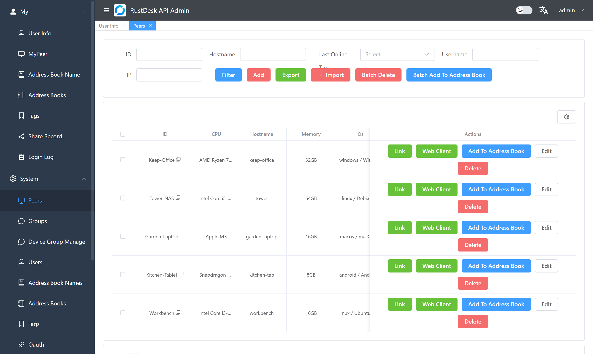
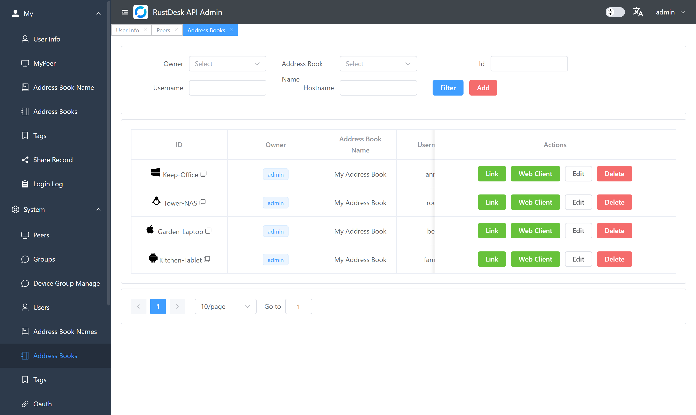

<p align="center">
  <picture>
    <source media="(prefers-color-scheme: dark)" srcset="https://raw.githubusercontent.com/junkerderprovinz/rustdesk/main/.github/assets/rustdesk-banner-dark.png">
    
  </picture>
</p>

<p align="center">
  <a href="https://github.com/junkerderprovinz/rustdesk/actions/workflows/build.yml"></a>&nbsp;
  <a href="https://github.com/junkerderprovinz/rustdesk/actions/workflows/lint.yml"></a>&nbsp;
  <a href="https://hub.docker.com/r/junkerderprovinz/rustdesk"></a>&nbsp;
  <a href="https://hub.docker.com/r/junkerderprovinz/rustdesk"></a>&nbsp;
  <a href="https://github.com/junkerderprovinz/rustdesk/pkgs/container/rustdesk"></a>&nbsp;
  <a href="https://github.com/lejianwen/rustdesk-api"></a>&nbsp;
  <a href="LICENSE"></a>
</p>

<br>

<p align="center">
Your own <b>RustDesk</b> server for Unraid, in one container. The ID server and the
relay come with a web console, user accounts, an address book that follows you to
every client and a web client in the browser. Devices can also change their ID,
which the stock open-source server refuses. The buttons under the first row lead
to RustDesk's own clients.
</p>

<!-- download-buttons: written by scripts/gen_download_buttons.py -->
<p align="center">
  <a href="https://unraid.net/community/apps?q=rustdesk"></a>
  &nbsp;
  <a href="https://mos-official.net/apps.html?search=RustDesk"></a>
  &nbsp;
  <a href="https://github.com/junkerderprovinz/zimaos-apps#install"></a>
  &nbsp;
  <a href="https://github.com/junkerderprovinz/umbrel-apps#install"></a>
</p>
<p align="center">
  <a href="https://raw.githubusercontent.com/junkerderprovinz/rustdesk/main/compose.yaml"></a>
  &nbsp;
  <a href="https://github.com/junkerderprovinz/rustdesk/releases/latest"></a>
</p>
<br>
<p align="center">
  <a href="https://github.com/rustdesk/rustdesk/releases/latest"></a><a href="https://github.com/rustdesk/rustdesk/releases/latest"></a>
  &nbsp;
  <a href="https://github.com/rustdesk/rustdesk/releases/latest"></a>
  &nbsp;
  <a href="https://github.com/rustdesk/rustdesk/releases/latest"></a><a href="https://github.com/rustdesk/rustdesk/releases/latest"></a>
</p>
<br>
<p align="center">
  <a href="https://f-droid.org/packages/com.carriez.flutter_hbb/"></a>
  &nbsp;
  <a href="https://github.com/rustdesk/rustdesk/releases/latest"></a>
  &nbsp;
  <a href="https://apps.apple.com/app/rustdesk-remote-desktop/id1581225015"></a>
</p>
<!-- /download-buttons -->

<br>

<p align="center">
A one-knight job: I build it, keep it running, work through the issues and add what people ask for, until nothing is missing. It is free, with no accounts, no telemetry, no ads and no paid tier. No asterisk anywhere. Nothing readable ever leaves your own walls. Forged on evenings and weekends, with heart and stubbornness.
</p>

<p align="center">
If it has earned a place on your server or computer, toss a coin to your knight: it helps cover the costs and keeps the project alive. It also makes this knight's heart beat a little faster. Three ways below, whichever suits you.
</p>

<!-- give-buttons: written by scripts/gen_download_buttons.py -->
<p align="center">
  <a href="https://buymeacoffee.com/junkerderprovinz"></a>
  &nbsp;
  <a href="https://www.paypal.com/donate/?hosted_button_id=76FVV52TKXTUS"></a>
  &nbsp;
  <a href="https://junkerderprovinz.github.io/junkerderprovinz/"></a>
</p>
<!-- /give-buttons -->

<br>

## Table of Contents

1. [What it looks like](#1-what-it-looks-like)
2. [What it does](#2-what-it-does)
3. [How it compares](#3-how-it-compares)
4. [Getting started](#4-getting-started)
5. [Connecting your devices](#5-connecting-your-devices)
6. [Changing a device's ID](#6-changing-a-devices-id)
7. [Moving from another RustDesk server](#7-moving-from-another-rustdesk-server)
8. [What is inside](#8-what-is-inside)
9. [How AI is used here](#9-how-ai-is-used-here)
10. [Support this project](#10-support-this-project)

<br>

## 1. What it looks like

<p align="center">
  
  <br><em>Every device that registered with your server, with its system, when it was last online and one click to connect.</em>
</p>

<p align="center">
  
  <br><em>The address book a user sees in every RustDesk client they log in to.</em>
</p>

<br>

## 2. What it does

- `hbbs` hands out IDs and introduces your devices to each other. `hbbr` relays the session when two devices cannot reach each other directly. By default the server accepts encrypted connections only.
- The web console on port 21114, at `/_admin/`, lists devices, users, groups and address books, keeps the connection and file transfer logs, and holds the server's settings.
- You log in once in the RustDesk client and your address book is there on every device you use. Your own server keeps it.
- The web client at `/webclient/` opens a session from a browser on a machine without RustDesk, and you can share access with a guest through it.
- A device can change its ID in the client. The server accepts the change when it comes from the same machine and the new ID is free.
- On Unraid it is one container with two volumes, and every setting is in the template.

<br>

## 3. How it compares

| | **This image** | ich777 AIO | Official server | RustDesk Server Pro |
|---|:---:|:---:|:---:|:---:|
| ID server and relay | ✅ | ✅ | ✅ | ✅ |
| Web console | ✅ | ❌ | ❌ | ✅ |
| Accounts and shared address book | ✅ | ❌ | ❌ | ✅ |
| Web client | ✅ | ❌ | ❌ | ✅ |
| Change a device's ID | ✅ | ❌ | ❌ | ✅ |
| Multi-arch | amd64 + arm64 | amd64 | amd64 + arm64 + armv7 | amd64 + arm64 + armv7 |
| Licence | AGPL-3.0 | AGPL-3.0 | AGPL-3.0 | proprietary |
| Price | free | free | free | paid subscription |

The official server is `rustdesk/rustdesk-server`; ich777's all-in-one image is the one in Unraid's Community Applications.

<br>

## 4. Getting started

**Unraid:** install RustDesk from [Community Applications](https://unraid.net/community/apps?q=rustdesk) and fill in the address your clients use to reach the server (a DNS name or IP) in the four address fields.

**Docker Compose:** take [compose.yaml](compose.yaml), replace `rustdesk.example.com` with your server's address and run `docker compose up -d`.

- **Synology:** in Container Manager, create a project from the file (DSM 7.2 or newer).
- **Proxmox:** run it in a VM or an LXC container that has Docker.
- **MOS:** install RustDesk from the [MOS Hub](https://mos-official.net/apps.html?search=RustDesk) and fill in the four address fields.
- **ZimaOS and CasaOS:** add the [community store](https://github.com/junkerderprovinz/zimaos-apps#install) and install RustDesk with Custom Installation, where you fill in the four addresses.
- **umbrelOS:** add the [community app store](https://github.com/junkerderprovinz/umbrel-apps#install) and install RustDesk from it. The addresses point to your Umbrel by itself, and the API server for the clients is `http://umbrel.local:35135`.

On the first start the server creates its key pair in `/data` and the console creates the account `admin` and prints its password in the container log:

```
docker logs rustdesk 2>&1 | grep -i password
```

Log in at `http://<server>:21114/_admin/`, change the password, and the server is ready. If the line has scrolled away, set a new one:

```
docker exec rustdesk /app/apimain reset-admin-pwd <new password>
```

Ports: 21114 (console and web client), 21115 (NAT test), 21116 TCP and UDP (ID server), 21117 (relay), 21118 and 21119 (websocket variants for the web client). Forward 21115 to 21117 if devices outside your network should connect; the console does not need to be reachable from outside.

<br>

## 5. Connecting your devices

Get the client from RustDesk's [releases](https://github.com/rustdesk/rustdesk/releases/latest), [F-Droid](https://f-droid.org/packages/com.carriez.flutter_hbb/) or the [App Store](https://apps.apple.com/app/rustdesk-remote-desktop/id1581225015), or with the buttons at the top. Then open **Settings → Network → ID/Relay server** and enter:

| Field | Value |
| --- | --- |
| ID server | `<server>:21116` |
| Relay server | `<server>:21117` |
| API server | `http://<server>:21114` |
| Key | the content of `/data/id_ed25519.pub` |

With the API server set, the client shows a login. Log in with a user from the console and your address book appears; it syncs to every device where you log in with the same user.

<br>

## 6. Changing a device's ID

The client's **Change ID** works against this server. The server renames the device only when the request comes from the machine that registered the old ID, and only to an ID that is free and follows RustDesk's format (6 to 16 characters, starting with a letter). The stock open-source server answers the same request with "not supported".

<br>

## 7. Moving from another RustDesk server

Your devices keep their IDs and trust the new server when it uses the same key pair. Stop the old container and copy `id_ed25519`, `id_ed25519.pub` and `db_v2.sqlite3` from its data folder into this container's `/data` before the first start. The key the clients use stays the same, so nothing has to change on the devices.

<br>

## 8. What is inside

- `hbbs`, `hbbr` and `rustdesk-utils` built from [lejianwen/rustdesk-server](https://github.com/lejianwen/rustdesk-server), a fork of [rustdesk-server](https://github.com/rustdesk/rustdesk-server) that talks to the API, with the patches in [patches/](patches) applied.
- [lejianwen/rustdesk-api](https://github.com/lejianwen/rustdesk-api) for the console, the accounts, the address book and the web client.
- s6-overlay to run the three.

The newer web client that older rustdesk-api images shipped as `/webclient2` was removed upstream after a DMCA notice and is not included.

<br>

## 9. How AI is used here

One knight builds this, and AI is one of the tools I work with, the same way I work with an editor or a compiler. It helps me write code and documentation and it checks my work, and that saves me a good many evenings. It does not make the decisions, though. I read and understand everything before it ships, and if something here breaks, that is on me and not on the tool.

You do not have to take my word for it. The code is open and every release note is written by hand. The issue tracker shows how problems actually get handled, including the ones I got wrong the first time. If you find something that is not right, open an issue and I will look at it.

<br>

## 10. Support this project

Bugs, ideas or feature requests? Please [open a GitHub issue](https://github.com/junkerderprovinz/rustdesk/issues).

A one-knight job: I build it, keep it running, work through the issues and add what people ask for, until nothing is missing. It is free, with no accounts, no telemetry, no ads and no paid tier. No asterisk anywhere. Nothing readable ever leaves your own walls. Forged on evenings and weekends, with heart and stubbornness.

If it has earned a place on your server or computer, toss a coin to your knight: it helps cover the costs and keeps the project alive. It also makes this knight's heart beat a little faster. Three ways below, whichever suits you.

<!-- give-buttons: written by scripts/gen_download_buttons.py -->
<p align="center">
  <a href="https://buymeacoffee.com/junkerderprovinz"></a>
  &nbsp;
  <a href="https://www.paypal.com/donate/?hosted_button_id=76FVV52TKXTUS"></a>
  &nbsp;
  <a href="https://junkerderprovinz.github.io/junkerderprovinz/"></a>
</p>
<!-- /give-buttons -->

<br>

<sub>The packaging in this repository is AGPL-3.0. RustDesk server, rustdesk-api and s6-overlay keep their own licences; see [NOTICE](NOTICE). RustDesk is a trademark of its owners; this project is not affiliated with them.</sub>
